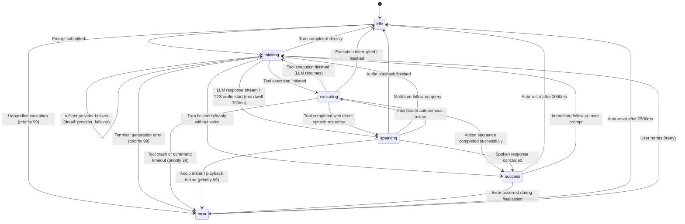
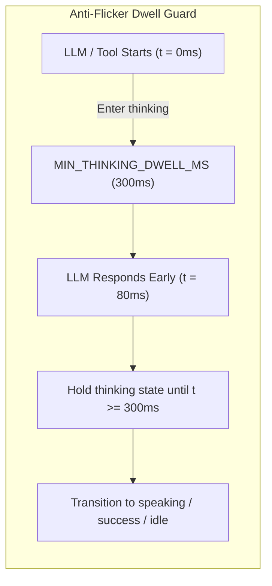

# Elenalyse Reactive Avatar Finite State Machine (FSM) Design Specification

## 1. Architectural Overview & Context

Elenalyse features a dual-process architecture comprising an interactive CLI developer assistant and a lightweight, frameless, transparent 3D desktop companion powered by Tauri v2, Vite, Three.js, and `@pixiv/three-vrm`.

To achieve seamless, life-like responsiveness without multi-port IPC overhead, the system leverages a **Unified Bridge Architecture** on `http://127.0.0.1:39420`. The CLI acts as the authoritative state producer, streaming lifecycle events over Server-Sent Events (SSE) to the desktop overlay, which acts as the reactive consumer driving the 3D VRM avatar state machine.

```mermaid
flowchart TD
    subgraph CLI ["Elenalyse CLI Engine (Node.js / TS)"]
        CLI_Input["User Input / REPL Prompt / Party Mode"]
        CLI_LLM["LLM Orchestration (Vercel AI SDK)"]
        CLI_Tools["Autonomous Tools (readFile, editFile, runCommand)"]
        CLI_TTS["VOICEVOX Engine (Phoneme & Viseme Analysis)"]
        CLI_Failover["Failover Controller (429/Quota/Timeout Recovery)"]
        CLI_Bridge["Unified SSE Bridge Server (127.0.0.1:39420)"]

        CLI_Input --> CLI_LLM
        CLI_LLM --> CLI_Tools
        CLI_Tools --> CLI_LLM
        CLI_LLM --> CLI_Failover
        CLI_Failover --> CLI_LLM
        CLI_LLM --> CLI_TTS

        CLI_Input -.->|thinking| CLI_Bridge
        CLI_Tools -.->|executing| CLI_Bridge
        CLI_TTS -.->|speaking| CLI_Bridge
        CLI_LLM -.->|success| CLI_Bridge
        CLI_Failover -.->|"thinking (detail: provider_failover)"| CLI_Bridge
    end

    subgraph Desktop ["Desktop Companion Overlay (Tauri v2 + Three.js)"]
        SSE_Client["SSE Client (EventSource @ /events)"]
        FSM_Controller["Avatar FSM Controller"]
        Anim_Blender["Animation & Expression Crossfader"]
        LipSync_Engine["Viseme LipSync Engine (aa, ih, ou, ee, oh)"]
        VRM_Model["Three.js VRM Avatar (ELI / REI)"]

        SSE_Client -->|avatar:state| FSM_Controller
        SSE_Client -->|speak| LipSync_Engine
        SSE_Client -->|persona| FSM_Controller

        FSM_Controller --> Anim_Blender
        LipSync_Engine --> Anim_Blender
        Anim_Blender --> VRM_Model
    end

    CLI_Bridge ===|HTTP SSE Stream (Single Port 39420)| SSE_Client
```

---

## 2. 6-State Reactive FSM Specification

The avatar's behavior is modeled as a deterministic 6-state finite state machine consisting of:
- **1 Base State**: `idle`
- **5 Reactive AI States**: `thinking`, `speaking`, `executing`, `success`, `error`



### State Definitions

1. **`idle` (Base State, Priority 0)**:
   - **Characteristics**: `loop: true`, `crossfadeDurationMs: 250`.
   - **Visuals**: Default natural Kuudere resting poses, breathing cycle (procedural sine modulation on chest and spine), natural eye saccades (intermittent focal shifts), and random double/single eyelid blinks (2.5s–6.5s interval).

2. **`thinking` (Priority 1)**:
   - **Characteristics**: `loop: true`, `crossfadeDurationMs: 250`.
   - **Visuals**: Contemplative posture (slight head tilt, eyes slightly raised or glancing away in thought, gentle arm shift).
   - **Anti-Flicker Dwell Guard**: Subject to `MIN_THINKING_DWELL_MS = 300` to prevent visual flicker when responses or tool checks resolve in under 100ms.
   - **Recoverable Failover**: In-flight provider failovers retain `thinking` with `detail: "provider_failover"` to maintain visual continuity while the fallback LLM generates.

3. **`speaking` (Priority 2)**:
   - **Characteristics**: `loop: true`, `crossfadeDurationMs: 250`.
   - **Visuals**: Expressive head gestures, emotive eyebrow and mouth blendshapes driven by VOICEVOX visemes (`aa`, `ih`, `ou`, `ee`, `oh`), natural hand movement.

4. **`executing` (Priority 2)**:
   - **Characteristics**: `loop: true`, `crossfadeDurationMs: 250`.
   - **Visuals**: Focused analytical inspection posture (e.g. slight lean, subtle rhythmic nodding / processing cues).
   - **Detail Payload**: Carries the currently executing tool name and autonomous step index (e.g. `readFile (step 2/25)`).

5. **`success` (Priority 3)**:
   - **Characteristics**: `loop: false`, `crossfadeDurationMs: 250`, `autoResetMs: 2000`.
   - **Visuals**: Subtle pleased nod, satisfied expression, gentle relaxation.
   - **Auto-Reset**: Returns gracefully to `idle` after 2000ms unless a new prompt or state is dispatched.

6. **`error` (Priority 99 - Preemptive)**:
   - **Characteristics**: `loop: false`, `crossfadeDurationMs: 150`, `autoResetMs: 2500`.
   - **Visuals**: Troubled or alert expression (furrowed brows, slight recoil or head shake).
   - **Preemption**: Preempts all other states with a fast 150ms crossfade.
   - **Auto-Reset**: Automatically triggers a graceful transition back to `idle` after 2500ms.

---

## 3. State Transition Matrix

| Source State | Target State | Legal? | Trigger Event | Min Dwell | Crossfade | Priority | Auto-Reset |
| :--- | :--- | :---: | :--- | :---: | :---: | :---: | :---: |
| `idle` | `thinking` | Yes | Prompt submitted via REPL, single-chat, or `/fix` | 300ms | 250ms | 1 | - |
| `idle` | `executing` | Yes | Direct autonomous script execution | - | 250ms | 2 | - |
| `idle` | `error` | Yes | Bridge startup or system-level error | - | 150ms | 99 | 2500ms |
| `thinking` | `executing` | Yes | Model outputs tool call (`readFile`, `runCommand`, etc.) | - | 250ms | 2 | - |
| `thinking` | `speaking` | Yes | Model stream produces voice lines & audio synthesis begins | 300ms dwell | 250ms | 2 | - |
| `thinking` | `success` | Yes | Turn finished cleanly (silent or completed action) | - | 250ms | 3 | 2000ms |
| `thinking` | `idle` | Yes | Generation finishes (direct return) | - | 250ms | 0 | - |
| `thinking` | `thinking` | Yes | In-flight provider failover retry (`detail: "provider_failover"`) | 300ms | 250ms | 1 | - |
| `thinking` | `error` | Yes | Terminal generation failure (API quota, invalid key, 500) | - | 150ms | 99 | 2500ms |
| `executing` | `thinking` | Yes | Tool execution returns output; LLM resumes evaluation | 300ms | 250ms | 1 | - |
| `executing` | `speaking` | Yes | Autonomous tool reports interim voice feedback | - | 250ms | 2 | - |
| `executing` | `success` | Yes | Tool task batch successfully completed | - | 250ms | 3 | 2000ms |
| `executing` | `idle` | Yes | User aborts autonomous loop (SIGINT / Ctrl+C) | - | 250ms | 0 | - |
| `executing` | `error` | Yes | Fatal tool execution crash or command timeout | - | 150ms | 99 | 2500ms |
| `speaking` | `idle` | Yes | Audio playback queue empties | - | 250ms | 0 | - |
| `speaking` | `success` | Yes | Speech segment concluded successfully | - | 250ms | 3 | 2000ms |
| `speaking` | `thinking` | Yes | Interleaved speech segment triggers next thinking chunk | 300ms | 250ms | 1 | - |
| `speaking` | `executing` | Yes | Speech directs next tool execution | - | 250ms | 2 | - |
| `speaking` | `error` | Yes | Audio device or decoder failure | - | 150ms | 99 | 2500ms |
| `success` | `idle` | Yes | Auto-reset timer expires (2000ms) | - | 250ms | 0 | - |
| `success` | `thinking` | Yes | User immediately submits follow-up prompt | 300ms | 250ms | 1 | - |
| `success` | `error` | Yes | Error during finalization | - | 150ms | 99 | 2500ms |
| `error` | `idle` | Yes | Auto-reset timer expires (2500ms) | - | 250ms | 0 | - |
| `error` | `thinking` | Yes | User triggers `/retry` command | 300ms | 250ms | 1 | - |

---

## 4. CLI Lifecycle Mapping Table

The table below correlates exact Elenalyse CLI lifecycle hooks with corresponding FSM transition dispatches.

| Lifecycle Event | CLI Location | Dispatched State | Payload Details |
| :--- | :--- | :--- | :--- |
| **Prompt Submitted (REPL / Chat)** | `src/index.ts` -> `src/chat.ts` | `thinking` | `{ event: "state_change", state: "thinking", detail: "prompt_submitted" }` |
| **Party Mode Quartet Started** | `src/party.ts#runPartyOrchestration` | `thinking` | `{ event: "state_change", state: "thinking", detail: "party_mode_quartet" }` |
| **Native Tool Call Emitted** | `src/chat.ts` (`genResult.toolCalls.length > 0`) | `executing` | `{ event: "state_change", state: "executing", detail: "calling <toolName> [Step N/M]" }` |
| **Text-Based Tool Call** | `src/chat.ts` (`extractTextToolCalls`) | `executing` | `{ event: "state_change", state: "executing", detail: "calling <toolName> [Step N/M]" }` |
| **Tool Execution Returned** | `src/chat.ts` (`currentMessages.push(toolResult)`) | `thinking` | `{ event: "state_change", state: "thinking", detail: "evaluating_tool_result" }` |
| **In-Flight Provider Failover** | `src/chat.ts` (catch `isFailoverError`) | `thinking` | `{ event: "state_change", state: "thinking", detail: "provider_failover" }` |
| **TTS Speech Playback Start** | `src/chat.ts#playVoiceLines` -> `broadcastSpeakEvent` | `speaking` | `{ event: "state_change", state: "speaking", detail: "speaking_line_<index>" }` |
| **Speech Playback Finished** | `src/chat.ts#playVoiceLines` (post loop) | `success` | `{ event: "state_change", state: "success", detail: "turn_complete" }` |
| **Turn Completed (Text Only)** | `src/chat.ts` (post markdown render) | `success` | `{ event: "state_change", state: "success", detail: "turn_complete" }` |
| **User SIGINT / Abort** | `src/chat.ts` (`sigintHandler` / `isAborted`) | `idle` | `{ event: "state_change", state: "idle", detail: "user_aborted" }` |
| **Terminal Error / Crash** | `src/chat.ts` (catch block post-fallback) | `error` | `{ event: "state_change", state: "error", detail: error.message }` |
| **Persona Switched** | `src/chat.ts` (`/persona <name>`) | `idle` | Broadcasts `persona` event + `idle` state |

---

## 5. Architectural Refinements

### Refinement 1: Unified Bridge Architecture (`127.0.0.1:39420`)
Instead of launching a separate HTTP port or WebSocket server for avatar state events, the existing SSE Bridge in `src/bridge.ts` is unified and extended:
1. **Backward Compatibility**:
   - Existing `speak` events (`VoiceEventPayload` with audio base64, duration, and viseme cues) remain completely intact.
   - Existing `persona` events (`{ persona: string }`) continue to broadcast without disruption.
2. **New Dedicated State Channel**:
   - Introduces `event: avatar:state` (with alias `event: state`) carrying typed `AvatarStatePayload` records (`event: "state_change"`).
3. **Single Port Efficiency**:
   - Avoids port collision, dual firewall alerts, and multi-stream synchronization drift.
   - Retains 15-second heartbeat (`: ping\n\n`) to prevent browser EventSource timeout.

### Refinement 2: Distinguishing Recoverable Failover vs. Terminal Error
A critical architectural pitfall in naive FSM implementations is treating all errors identically.
- **Terminal Error (`error`)**:
  - Occurs when an unrecoverable failure occurs (e.g. fatal API crash, network down with no fallback, invalid credentials).
  - Triggers a fast 150ms crossfade to the troubled avatar expression with priority 99.
  - Automatically resets to `idle` after 2500ms via `autoResetMs = 2500`.
- **In-Flight Recoverable Failover (`thinking` with `detail: "provider_failover"`)**:
  - Occurs when the primary provider returns a transient error (e.g. HTTP 429 rate limit, quota exhaustion, 503 overload) caught by `isFailoverError()`.
  - The CLI automatically switches to `config.fallbackProvider` and retries the turn.
  - **Why it must NOT enter `error`**: If the avatar entered `error`, its 2500ms auto-reset timer would fire while the fallback provider was still generating, causing the avatar to revert to `idle` while actively thinking.
  - Instead, the avatar remains in (or immediately updates) `thinking` with `detail: "provider_failover"`.

### Refinement 3: VRM Asset Synchronization & Git Hygiene
The project includes two high-fidelity 3D models in `assets/models/`:
- `ELI_Model.vrm` (~18.7 MB)
- `REI_Model.vrm` (~19.1 MB)

While `REI_Model.vrm` is currently copied into `desktop/public/models/`, syncing `ELI_Model.vrm` is required for full multi-persona support.
To avoid bloating Git history with duplicate 19MB binary blobs:
1. `desktop/public/models/` should ideally be populated at build time or symlinked.
2. If committed statically to `desktop/public/models/`, ensure clean one-time asset staging so history size is preserved without repeated binary commits.

---

## 6. Timing & Performance Guarantees



- **`MIN_THINKING_DWELL_MS = 300`**: Guaranteed minimum dwell duration in `thinking` state to suppress UI jitter and micro-flicker caused by cached tool evaluations or instant mock responses.
- **Crossfade Durations**:
  - Standard crossfade: `250ms` (0.25s) across `idle`, `thinking`, `speaking`, `executing`, and `success`.
  - Error preemption crossfade: `150ms` (0.15s) for immediate high-priority alert reaction.
- **Auto-Reset Durations**:
  - `success`: `2000ms` auto-reset back to `idle`.
  - `error`: `2500ms` auto-reset back to `idle`.
- **Preemption Priority**:
  - `error`: Priority `99` (preempts everything immediately).
  - `success`: Priority `3`.
  - `speaking` & `executing`: Priority `2`.
  - `thinking`: Priority `1`.
  - `idle`: Priority `0`.
